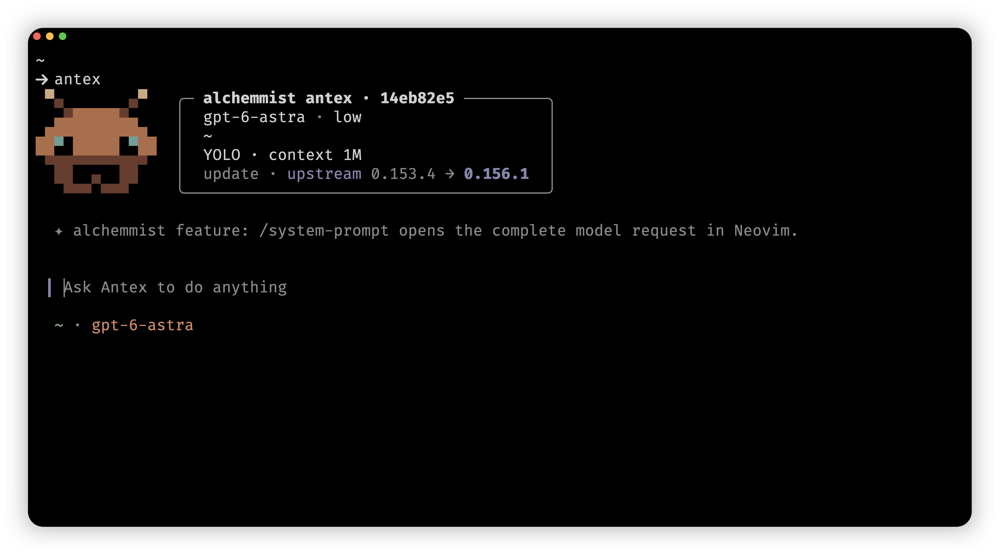

# Antex

A terminal-native coding agent built on [OpenAI Codex](https://github.com/openai/codex) and kept in sync with upstream.



## What's included

- `/simplify [focus]` reviews changed code for reuse, quality, and efficiency with three parallel reviewers, then applies worthwhile behavior-preserving fixes.
- The TUI uses the terminal palette and updates the composer, conversation history, plans, and diffs immediately when the terminal theme changes.
- The configurable startup cockpit identifies alchemmist antex, shows its exact build commit, rotates fork-specific feature tips, and includes two animated ant mascot skins.
- `Ctrl+S` stashes the current prompt draft, persists it across restarts, and restores it on the next press.
- `/subagents` toggles subagent mode for subsequent prompts in the current chat, restores the setting on resume, and can update an active turn.
- `/statusline` can show the number of active subagents, while `/agents` opens an overview of their work.
- Fast mode is process-local, resets to standard on every start or resume, and shows `⚡` in the status line while active.
- `/cd <path>` changes the current session's working directory without restarting Antex.
- `/todo` shows the complete plan, while a compact adaptive list of active items remains visible at the bottom of the TUI.
- `/workflow` runs configurable Python workflows with persistent state, per-agent models and reasoning, and parallel-agent support. The PR babysitter keeps CI and review feedback moving with fresh repair agents and forbids Quality Graph ignores.
- `/tmux-command-log` creates a separate tmux window containing Antex commands and their output.
- `/context` summarizes the model-visible context, while `/system-prompt` opens the complete latest logical model request in Neovim inside a new tmux window.
- `/dump` exports the full conversation to a responsive HTML file styled like [alchemmist.xyz](https://alchemmist.xyz), with tool activity collapsed between messages.
- The composer and submitted user messages share a cyan vertical rail, making prompts easy to find throughout the conversation.
- Vim editing supports Insert, Normal, character/line/block Visual modes, Russian keyboard aliases, system-clipboard yanks, and terminal-native selection colors.
- Prompts interrupted before work begins return to the editor; later interruptions are shown without a noisy error message.
- Force pushes always require an explicit Yes or No selection in the TUI.
- Fixes include tmux pane resize redraws, focus-related flickering, and a stable `Working` animation.
- Install complete macOS and Linux releases with one curl command, or use the root `Makefile` for release downloads and local builds.

## Runtime

Interactive Antex runs its engine inside the foreground CLI process. New sessions,
resume, fork and worktrees do not discover, install or attach to a shared background
app-server. Subagents, Code Mode, approvals and saved history remain part of that
engine. Closing the foreground process ends its live work; saved sessions can be
resumed later.

The `app-server` command is an on-demand **stdio SDK interface**, not a separately
installed service. Code Mode and sandbox helpers remain ordinary process-owned
helpers. Existing launchers may still pass `--no-daemon`; it is a compatibility
no-op. Cross-client local `antex queue` submission is no longer supported: submit
queued input in the running TUI instead.

Installing a new CLI does not terminate old clients or remove a previous release's
running daemon, history or credentials. Open a new foreground session to use the new
engine; retiring old services is a separate operation after their clients are idle.

## Install

Install the latest release without cloning the repository:

```shell
curl -fsSL https://raw.githubusercontent.com/alchemmist/antex/main/scripts/install/install.sh | sh
```

The installer detects macOS (Apple Silicon) or Linux (x86_64), verifies SHA-256 checksums, and installs the complete package, including Code Mode and bundled tools. It needs `curl`, `sh`, `tar`, and standard system utilities; Git, Make, Python, and Rust are not required. Current prebuilt Linux releases require glibc 2.39+ and OpenSSL 3 (`libssl.so.3`); release builds are tested on Ubuntu 24.04.

The command is installed in `~/.local/bin`, and packages are stored under `~/.antex/packages/standalone`. The installer configures your shell's PATH when needed. Open a new terminal and run `antex`, or follow the launch command printed by the installer. Run the same installation command again to update.

To install a specific release:

```shell
curl -fsSL https://raw.githubusercontent.com/alchemmist/antex/main/scripts/install/install.sh | sh -s -- --release 0.1.4
```

`ANTEX_INSTALL_DIR` changes the command directory; `ANTEX_HOME` changes the data and package directory. Set `ANTEX_NON_INTERACTIVE=1` on the `sh` process to skip optional prompts:

```shell
curl -fsSL https://raw.githubusercontent.com/alchemmist/antex/main/scripts/install/install.sh | ANTEX_NON_INTERACTIVE=1 sh
```

## Build and install from a checkout

```shell
make install-local
make install-mac
make install-linux
```

### ChatGPT subscription sign-in

Checkout builds support direct ChatGPT subscription access to the public OpenAI Responses API. This flow is not included in the published v0.1.14 binaries:

```shell
antex login --chatgpt-direct
antex -m gpt-6-astra
```

Complete the browser sign-in with port `127.0.0.1:1455` available. For a remote installation, forward that callback port to the machine running Antex. Antex registers its own OAuth client and refreshes its own credentials; it does not import another agent's tokens. Existing credentials are replaced only after a successful sign-in.

CLI sign-in updates the credential store, not an already-running server's in-memory account. Before switching via the CLI, finish active work and stop the background server; then start a new Antex session with this build. In particular, the published v0.1.14 server does not understand direct auth.

Plain `antex login` and `antex login --device-auth` retain the legacy Codex sign-in flow; API-key login is unchanged. Direct sign-in does not grant access to Codex-only cloud services or usage endpoints. Actual model availability is determined by the API and the granted account access, not just the model picker.

Upstream documentation: [developers.openai.com/codex](https://developers.openai.com/codex).

## Existing installations

Launch the application with `antex`. To bring over an existing installation, run `antex migrate` to inspect the source and destination. After stopping Codex clients, repeat the command with `--apply`, then use `antex resume`. The migration keeps the original data and writes the new home to `~/.antex`; `--source` and `--destination` select other locations. If the curl installer finds existing Codex data before the Antex home exists, it installs the binaries separately so you can run the migration first. Run the installer again after migrating to adopt the standard package layout; subsequent updates use the same installer.

`ANTEX_HOME` selects the Antex home. OpenAI service identifiers, model names, and existing session/protocol field names retain their upstream spelling for compatibility.

See [MIGRATION.md](MIGRATION.md) for project settings, matching helper binaries, and rollback instructions.
